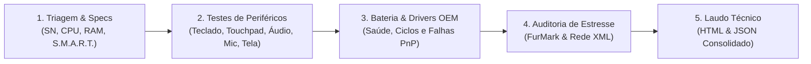

# 💻 TechTest — Suíte Profissional de Diagnóstico de Hardware e QA de Bancada

[](https://dotnet.microsoft.com/)
[-blue)](https://learn.microsoft.com/dotnet/maui/)
[](https://www.microsoft.com/windows)
[](https://github.com/mono/SkiaSharp)
[](https://github.com/naudio/NAudio)
[](#-direitos-autorais-e-licença)

---

## 📌 Visão Geral do Projeto

O **TechTest** é uma solução de engenharia de software desenvolvida para **diagnóstico avançado de hardware, controle de qualidade (QA) e inspeção funcional em bancadas técnicas**. 

Voltado para laboratórios de TI, centros de assistência técnica, operações de triagem de garantia (RMA) e empresas de recondicionamento de notebooks seminovos (*refurbishing*), o sistema substitui a utilização dispersa de softwares avulsos e testes manuais por uma plataforma unificada, visual e padronizada.

O software roda em ambiente nativo Windows como **aplicação desempacotada (*Unpackaged* / `WindowsPackageType=None`) e autossuficiente (*Self-Contained*)**, permitindo execução direta a partir de um pendrive sem depender de instalação prévia de runtimes ou privilégios de loja.

---

## 🔄 Fluxo Operacional de Bancada (Workflow)



1. **Triagem Instantânea:** Captura automática do Fabricante, Modelo, Número de Série / Service Tag limpo, especificações de componentes e saúde física de discos (S.M.A.R.T.).
2. **Inspeção de Periféricos:** Bateria de testes interativos com validação visual e auditiva de cada subsistema.
3. **Auditoria de Drivers & Bateria:** Identificação de dispositivos com códigos de erro PnP e cálculo de desgaste de bateria (*Wear Level*).
4. **Homologação e Certificação:** Registro de aprovação ou reprovação por etapa (`ApprovalBar`), culminando na emissão de laudo técnico para impressão e auditoria.

---

## ⚙️ Funcionalidades Detalhadas

### 1. 📊 Telemetria de Hardware e Saúde S.M.A.R.T. (`SpecsPage`)
- **Identificação Completa:** Coleta via WMI/BIOS de Fabricante, Modelo Comercial, Família, SKU, Placa-mãe e Número de Série com limpeza ativa de *placeholders* OEM (`"To be filled by O.E.M."`, `"Default string"`).
- **Processamento e Gráficos:** Modelo exato da CPU, total de memória RAM física e listagem de placas de vídeo (GPUs dedicadas e integradas) com driver e VRAM calculada.
- **Armazenamento Físico & S.M.A.R.T.:** Monitoramento via `MSFT_PhysicalDisk` e `MSFT_StorageReliabilityCounter`, expondo status de integridade, porcentagem de vida útil restante, temperatura de operação (°C) e horas totais em funcionamento.
- **Subsistema de Bateria Integrado:** Exibição imediata de status de carga, alimentação AC/DC, saúde da bateria, capacidade de projeto e ciclos.

### 2. 📋 Área de Transferência Resiliente (`ClipboardService`)
- **Execução Segura em STA:** Força a invocação na UI Thread (`MainThread.InvokeOnMainThreadAsync`) com política de retentativas para contornar bloqueios temporários de processo (`CLIPBRD_E_CANT_OPEN`).
- **Persistência após Perda de Foco:** Utiliza `Windows.ApplicationModel.DataTransfer.DataPackage` e `Clipboard.Flush()` nativos.
- **Fallback Nativo Win32 (User32):** Suporte nativo a aplicações desempacotadas através de `OpenClipboard` e `SetClipboardData(CF_UNICODETEXT)`, garantindo que o comando de cópia nunca falhe silenciosamente nem exiba mensagens vazias.
- **Comandos Dedicados no MVVM:**
  - `CopySerialNumberCommand`: Copia exclusivamente o Serial Number / Service Tag higienizado.
  - `CopyAllInfoCommand`: Gera um relatório estruturado contendo Fabricante, Modelo, SN, CPU, RAM, Armazenamento, SO e Bateria.

### 3. 📐 Seletor de Resolução e Aspect Ratio (`WindowResolutionService`)
- Permite simular e redimensionar dinamicamente a janela do aplicativo para resoluções padrão do mercado com indicação clara do aspect ratio correspondente:
  - **16:9:** `1366 x 768` (HD / WXGA), `1920 x 1080` (Full HD), `2560 x 1440` (QHD / 2K), `3840 x 2160` (UHD / 4K).
  - **16:10:** `1920 x 1200` (WUXGA).
- **Manipulação Nativa WinUI 3:** Redimensionamento via `AppWindow.ResizeClient(...)`. Restaura janelas maximizadas antes de aplicar as novas dimensões.
- **Clamping Inteligente:** Caso a resolução selecionada ultrapasse as dimensões da tela do operador, o sistema calcula a maior área útil permitida preservando rigorosamente a proporção (16:9 ou 16:10) e centraliza a janela no display.

### 4. ⌨️ Teste de Teclado com Detecção de Chattering (`KeyboardTestPage`)
- **Layout ABNT2 em SkiaSharp:** Desenho vetorial dinâmico ocupando 95% da tela útil, mapeando teclas exclusivas (`Ç`, `/ ?`, `\ |`, `AltGr`).
- **Diferenciação de Modificadores:** Trata separadamente Shift, Ctrl e Alt esquerdo e direito via interceptação de mensagens de teclado na janela nativa WinUI (`WndProc`).
- **Proteção de Foco:** Impede que teclas como `Tab`, `Espaço`, `Enter`, `Alt` e `F10` retirem o foco da janela.
- **Análise Mecânica em Tempo Real:** Identificação de *Key Rollover* simultâneo e detecção de *Key Chattering* (duplo disparo de chave física em intervalo inferior ao threshold milimétrico programado).

### 5. 🖱️ Scanner Físico de Precision Touchpad (`TouchpadTestPage`)
- **Win32 Raw Input Absoluto:** Conecta diretamente ao descritor HID do Precision Touchpad (`UsagePage 0x0D / Usage 0x05`) via `RegisterRawInputDevices`, capturando as coordenadas físicas `X/Y` absolutas da superfície do sensor, independentemente da aceleração do cursor do Windows.
- **Grade 15x10 de Zonas Mortas:** Mapeia toque contínuo na superfície para identificar áreas cegas ou trilhas rompidas.
- **Modo Legado PS/2:** Suporte para touchpads antigos prendendo o cursor à área do canvas com liberação via `ESC`.
- **Detecção de Ghost Touch:** Sinalização de toques espúrios registrados sem clique mecânico.

### 6. 🔋 Diagnóstico de Bateria e Desgaste (`BatteryTestPage`)
- Medição em tempo real de porcentagem de carga, taxa de descarga (mW), tensão e tempo estimado restante.
- Geração e análise automatizada do relatório nativo do Windows (`powercfg /batteryreport`) para extração de:
  - Capacidade de Projeto (*Design Capacity*).
  - Capacidade com Carga Total (*Full Charge Capacity*).
  - Nível de Desgaste Real (*Wear Level* em %).
  - Contagem de Ciclos de Carga e Fabricante da Célula.
- Identificação transparente de computadores de mesa ou notebooks sem bateria conectada.

### 7. 🔊 Teste de Áudio Estéreo e Fase (`AudioTestPage`)
- Síntese pura de ondas senoidais isoladas por canal (Canal Esquerdo, Canal Direito e Ambos em Estéreo).
- Visualização gráfica reativa em tempo real com indicador de amplitude e fase no `SpeakerCanvasView`.

### 8. 🎙️ Teste de Microfone com Osciloscópio (`MicrophoneTestPage`)
- Captura de áudio de baixa latência com isolamento de saída para prevenir microfonia.
- Osciloscópio em tempo real com SkiaSharp exibindo forma de onda contínua, medidor de pico em decibéis (dBFS) e buffer de reprodução de teste da gravação capturada.

### 9. 📷 Teste de Câmera e Sensor Óptico (`CameraTestPage`)
- Enumeração de dispositivos de captura de vídeo com inicialização resiliente contra falhas de hardware ou drivers corrompidos.
- Visualização em tempo real para verificação de foco, fidelidade de cores e presença de artefatos no sensor.

### 10. 🖥️ Inspeção de Dead Pixel (`DeadPixelTestPage`)
- Exibição em tela cheia sem bordas para inspeção visual de pixels travados (*stuck pixels*), mortos (*dead pixels*) ou vazamento de luz de fundo (*backlight bleeding*) em fundos monocromáticos: Vermelho, Verde, Azul, Branco e Preto.

### 11. 🛠️ Atualizador de Drivers OEM (`DriverUpdatePage`)
- Varredura de dispositivos PnP em estado de falha (`ConfigManagerErrorCode != 0`).
- Reconhecimento automático da fabricante do equipamento e gatilho direto para utilitários oficiais:
  - **Dell:** Dell Command | Update CLI (`dcu-cli.exe`).
  - **Lenovo:** Lenovo System Update / Vantage.
  - **HP:** HP Support Assistant.
- Abertura direta do portal de suporte oficial preenchendo automaticamente o número de série da máquina.

### 12. 📄 Emissão de Laudo Técnico de Bancada (`ReportService`)
- Consolida os resultados de todos os testes da sessão de bancada em veredito único: **APROVADO**, **REPROVADO** ou **INCOMPLETO**.
- Exportação simultânea em dois formatos:
  - **HTML:** Layout técnico pronto para impressão com campos para assinatura física do técnico responsável.
  - **JSON:** Dados estruturados para integração com sistemas de ERP, ordem de serviço (O.S.) ou banco de dados de garantia.

---

## 🚀 Tecnologias e Arquitetura

| Camada | Tecnologias Utilizadas |
| :--- | :--- |
| **Linguagem & Runtime** | C# 12, .NET 8 (LTS) |
| **Framework de UI** | .NET MAUI 8 com WinUI 3 (Windows App SDK) |
| **Modo de Distribuição** | Desempacotado (*Unpackaged*, `WindowsPackageType=None`), *Self-Contained* x64 |
| **Renderização Gráfica** | SkiaSharp (`SKCanvasView`, `SKPaintSurfaceEventArgs`) |
| **Captura e Áudio** | NAudio, WASAPI, `Plugin.Maui.Audio` |
| **Interoperabilidade Nativa** | P/Invoke (`user32.dll`, `kernel32.dll`, `hid.dll`), Win32 Raw Input, WMI (`System.Management`) |
| **Arquitetura & DI** | MVVM (*Model-View-ViewModel*), `Microsoft.Extensions.DependencyInjection` |
| **Testes Automatizados** | xUnit (`TechTest.Tests`) |

---

## 📦 Como Compilar, Executar e Publicar

### Pré-requisitos
- **Sistema Operacional:** Windows 10 (Build 19041+) ou Windows 11 (x64).
- [.NET 8 SDK](https://dotnet.microsoft.com/download/dotnet/8.0) instalado com suporte ao workload MAUI:
  ```powershell
  dotnet workload install maui
  ```

---

### Execução em Ambiente de Desenvolvimento

Para rodar a aplicação a partir do código-fonte:

```powershell
# 1. Restaurar dependências
dotnet restore TechTest.slnx

# 2. Compilar e rodar a versão .NET MAUI para Windows
dotnet run --project TechTest.Maui\TechTest.Maui.csproj -f net8.0-windows10.0.19041.0
```

---

### Publicação para Pendrive Portátil (Versão Autossuficiente)

Para gerar uma pasta pronta para pendrive que funcione em qualquer computador com Windows x64 sem necessidade de instalar o .NET ou dependências externas:

```powershell
dotnet publish TechTest.Maui\TechTest.Maui.csproj -f net8.0-windows10.0.19041.0 -c Release -r win-x64 --self-contained true -p:WindowsPackageType=None -p:WindowsAppSDKSelfContained=true -o ./Pendrive_Maui
```

#### Estrutura gerada na pasta do Pendrive:
- `TechTest.Maui.exe` (Executável autônomo).
- Bibliotecas do Windows App SDK e runtimes C# embutidos.
- *(Opcional)*: Copie o executável do **`FurMark.exe`** para dentro desta pasta para habilitar o teste de estresse térmico com um clique.

---

## 📂 Estrutura do Repositório

```text
TechTest/
├── TechTest.slnx                  # Solução do projeto
├── .gitignore                     # Filtro de binários, pendrive e artefatos de build
├── README.md                      # Documentação técnica do projeto
├── Pendrive_Maui/                 # Pasta de publicação portátil (ignorada no git)
├── TechTest/                      # Aplicação legada Windows Forms
├── TechTest.Tests/                # Testes unitários automatizados xUnit
└── TechTest.Maui/                 # Aplicação principal .NET MAUI (WinUI 3)
    ├── App.xaml / AppShell.xaml   # Shell e navegação da interface
    ├── MauiProgram.cs             # Registro de serviços, DI e escudos globais de erro
    ├── Controls/                  # Controles SkiaSharp (Teclado, Áudio, Microfone)
    ├── Helpers/                   # Conversores e cálculos de responsividade
    ├── Platforms/Windows/         # Implementações nativas (Bateria, WMI, Interop)
    ├── Services/                  # ClipboardService, ResolutionService, Formatter, FurMark
    ├── ViewModels/                # Camada MVVM com comandos reativos
    └── Views/                     # Telas XAML de cada subsistema de diagnóstico
```

---

## ⚖️ Direitos Autorais e Licença

**Direitos Reservados © 2026 TechTest Development Team.**

Este projeto e seu código-fonte são de natureza **proprietária e confidencial**. Todos os direitos intelectuais, de criação e de exploração comercial são reservados aos seus respectivos titulares. É estritamente proibida a cópia, modificação, redistribuição, engenharia reversa ou sublicenciamento sem autorização prévia por escrito.
